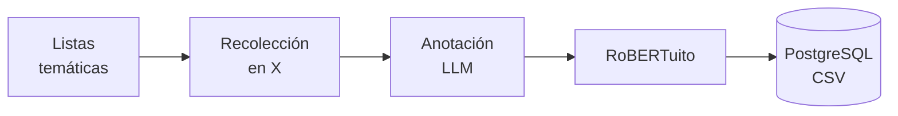

<div align="center">

# Análisis de sentimiento en publicaciones de X del contexto paraguayo

Recolección, anotación y clasificación de publicaciones sobre temas sociales en Paraguay.


[](LICENSE.txt)

</div>

## Índice

- [Resumen](#resumen)
- [Cómo funciona](#cómo-funciona)
- [Corpus](#corpus)
- [Instalación](#instalación)
- [Uso](#uso)
- [Estructura del repositorio](#estructura-del-repositorio)
- [Limitaciones](#limitaciones)
- [Cómo citar](#cómo-citar)
- [Autores](#autores)
- [Licencia](#licencia)

## Resumen

Este repositorio implementa un flujo completo para estudiar el sentimiento en publicaciones de X del contexto paraguayo: recolecta publicaciones por tema, las anota con un modelo de lenguaje según sentimiento, ironía, idioma y tipo de fuente, y las clasifica con RoBERTuito. Una API en FastAPI y un workflow de n8n coordinan las etapas, con almacenamiento en PostgreSQL, CSV y Google Sheets.

Incluye además el corpus construido con este flujo.

Trabajo Final de Grado · Ingeniería Informática · Universidad Nacional de Itapúa · 2026

## Cómo funciona



1. **Temas.** Las búsquedas parten de 23 categorías y 172 subtemas sociales, definidos en [`wordlist1.csv`](database/wordlist1.csv) y [`wordlist2.csv`](database/wordlist2.csv).
2. **Recolección.** Búsqueda en X filtrada por Paraguay y español, sin retuits, primero con Twikit y luego con la API oficial v2.
3. **Anotación.** GPT-5.6 Terra etiqueta sentimiento, ironía, idioma y fuente. El workflow de n8n valida la salida y registra el modelo y la versión del prompt. Los criterios están en el [clasificador LLM](llm_classifier/README.md).
4. **Segunda etiqueta.** RoBERTuito asigna un sentimiento independiente del LLM.
5. **Almacenamiento.** La API guarda cada lote en PostgreSQL y CSV, sin repetir publicaciones ya registradas.

## Corpus

El corpus reúne 2.003 publicaciones en español y jopara sobre temas sociales, con las etiquetas del LLM y de RoBERTuito. Está en [`tfg_corpus_final_dedup.csv`](tfg_corpus_final_dedup.csv).

Al finalizar la recolección, fuera del pipeline, se eliminaron los textos repetidos con un [notebook](find_duplicate_texts.ipynb); la exportación original se conserva en [`tfg_corpus_final.csv`](tfg_corpus_final.csv).

<details>
<summary>Diccionario de campos</summary>

| Campo | Descripción |
| --- | --- |
| `id` | Identificador interno del registro |
| `identifier` | Identificador de la publicación en X |
| `categoria`, `sub_categoria` | Tema y subtema de búsqueda |
| `created_at` | Fecha de publicación |
| `text` | Texto original |
| `sentiment_llm` | Sentimiento asignado por el LLM: `POS`, `NEG` o `NEU` |
| `llm_reason` | Justificación breve de la etiqueta |
| `has_irony` | Presencia de ironía o sarcasmo |
| `mixed` | Polaridad positiva y negativa equilibrada |
| `lang` | Idioma: `es` o `jopara` |
| `source_type` | Fuente: `ciudadano`, `medio`, `institucional` u `otro` |
| `discarded`, `discard_reason` | Descarte y motivo: `guarani` o `ininteligible` |
| `robuertuito` | Sentimiento asignado por RoBERTuito |
| `llm_model`, `llm_prompt_version`, `llm_classified_at` | Modelo, versión del prompt y fecha de la anotación |

</details>

## Instalación

### Requisitos

- Python 3.14
- PostgreSQL, con una base de datos y un usuario creados
- Token de X API con acceso a búsqueda histórica (`search_all`)
- Opcional: Docker para n8n y credenciales OAuth de Google para Sheets

### 1. Preparar el entorno

```bash
python -m venv .venv
source .venv/bin/activate
pip install -r requirements.txt
cp example.env .env
```

En Windows (PowerShell), la activación es `.venv\Scripts\Activate.ps1` y la copia, `Copy-Item example.env .env`.

### 2. Configurar `.env`

`example.env` solo lista los campos. Completalos en `.env`, que está excluido del repositorio por `.gitignore`. Los campos numéricos no pueden quedar vacíos.

| Variable | Descripción | Valor de referencia |
| --- | --- | --- |
| `DB_HOST`, `DB_PORT` | Servidor de PostgreSQL | `localhost`, `5432` |
| `DB_NAME`, `DB_USER`, `DB_PASSWORD` | Base de datos y usuario | — |
| `DB_DRIVER` | Driver de SQLAlchemy | `postgresql+psycopg` |
| `DB_ECHO` | Mostrar las consultas SQL | `false` |
| `COUNTRY` | País de búsqueda (`place_country`) | `PY` |
| `PAGE_DEPTH` | Máximo de páginas con datos nuevos por subtema | `100` |
| `EMPTY_STREAK_LIMIT` | Lotes seguidos sin datos nuevos antes de agotar un subtema | `1` |
| `PAGES_PER_STEP` | Páginas por paso de búsqueda | `2` |
| `USE_OLD` | `false`: X API v2 · `true`: Twikit | `false` |
| `X_BEARER_TOKEN` | Token de X API (si `USE_OLD=false`) | — |
| `AUTH_TOKEN`, `CT0` | Cookies de X para Twikit (si `USE_OLD=true`) | — |
| `SHEET_ID` | ID de la hoja de Google; obligatorio aunque no se use Sheets | `sin_configurar` |
| `GOOGLE_SHEETS_CREDENTIALS_FILE` | Ruta a las credenciales OAuth, fuera del repositorio | — |
| `EZSHEETS_CREDENTIALSFILENAME` | Ruta alternativa a las credenciales | — |
| `GOOGLE_SHEETS_MAX_RETRIES`, `GOOGLE_SHEETS_RETRY_BACKOFF_SECONDS` | Reintentos ante fallos de Sheets | `3`, `1.0` |
| `N8N_DB_NAME`, `N8N_DB_USER`, `N8N_DB_PASSWORD` | Base de datos de n8n | — |
| `N8N_BASIC_AUTH_USER`, `N8N_BASIC_AUTH_PASSWORD` | Acceso a n8n | — |
| `N8N_ENCRYPTION_KEY` | Clave de cifrado de n8n (`openssl rand -hex 32`) | — |
| `API_URL` | Dirección de la API vista desde n8n | `http://host.docker.internal:8000` |
| `MODEL` | Modelo LLM del workflow | `gpt-5.6-terra` |
| `SINCE_DATE`, `UNTIL_DATE` | Rango de fechas opcional (`YYYY-MM-DD`) | — |

Las variables de Google Sheets y n8n solo se necesitan si se usan esas integraciones.

### 3. Crear las tablas

```bash
alembic upgrade head
```

### 4. Iniciar la API

```bash
uvicorn main:app --reload
```

La documentación interactiva queda en [localhost:8000/docs](http://localhost:8000/docs).

### 5. n8n (opcional)

El servicio requiere una red de Docker `shared_network` y un PostgreSQL accesible en ella como `postgres-db:5432`, con una base de datos dedicada a n8n.

```bash
docker compose up -d n8n
```

En [localhost:5678](http://localhost:5678), importá [`TFG Pipeline.json`](TFG%20Pipeline.json), configurá la credencial del proveedor LLM en el nodo `OpenAI Chat Model` y probá con un lote pequeño antes de activar la programación.

### 6. Google Sheets (opcional)

Con `SHEET_ID` y la ruta a las credenciales OAuth completas, la API sincroniza el CSV con la hoja. Al iniciar descarga la hoja y reemplaza `corpus.csv`. Si no puede conectarse, sigue trabajando solo con el CSV local.

## Uso

### Cargar temas

```bash
python -m database.seed_topics database/wordlist1.csv
python -m database.seed_topics database/wordlist2.csv
```

El archivo usa las dos primeras columnas como categoría y subtema. Los pares existentes se omiten.

### Endpoints

| Método | Ruta | Función |
| --- | --- | --- |
| `GET` | `/available` | Próximo subtema disponible |
| `GET` | `/posts` | Publicaciones paginadas (`page`, `per_page`) |
| `POST` | `/register/topic` | Registrar un tema |
| `POST` | `/register/subtopic` | Registrar un subtema |
| `POST` | `/scrapper` | Buscar publicaciones en X |
| `POST` | `/upload-data/{subtopic_id}` | Guardar un lote clasificado |
| `POST` | `/subtopic/{subtopic_id}/exhaust` | Marcar un subtema como agotado |
| `POST` | `/sentiment` | Sentimiento de una publicación con RoBERTuito |
| `POST` | `/sentiment/batch` | Sentimiento de un lote con RoBERTuito |

### Ejemplos

Registrar un tema y un subtema:

```bash
curl -X POST http://localhost:8000/register/topic \
  -H 'Content-Type: application/json' \
  -d '{"name": "Transporte"}'

curl -X POST http://localhost:8000/register/subtopic \
  -H 'Content-Type: application/json' \
  -d '{"name": "transporte público", "topic_id": 1}'
```

Buscar publicaciones:

```bash
curl -X POST http://localhost:8000/scrapper \
  -H 'Content-Type: application/json' \
  -d '{"name": "transporte público", "type": "Latest", "date_init": "2026-01-01", "date_end": "2026-02-01"}'
```

Si la respuesta incluye `pagination_token`, se envía en la siguiente búsqueda para continuar.

### Pruebas manuales

```bash
python -m scrapper.test              # consulta real a X
python -m sentiment_analyzer.test    # análisis local con RoBERTuito
```

## Estructura del repositorio

<details>
<summary>Ver estructura</summary>

```text
.
├── main.py                  # API y rutas
├── config.py                # Configuración desde .env
├── schemas.py               # Esquemas de entrada y salida
├── app/                     # Recolección, carga y avance de subtemas
├── scrapper/                # Cliente de X
├── sentiment_analyzer/      # RoBERTuito
├── llm_classifier/          # Prompt, esquema y criterios de anotación
├── database/                # Entidades, listas temáticas y seeders
├── migrations/              # Migraciones de Alembic
├── handlers/                # CSV y Google Sheets
├── docs/                    # Licencias de dependencias
├── TFG Pipeline.json        # Workflow de n8n
├── find_duplicate_texts.ipynb
├── tfg_corpus_final.csv
└── tfg_corpus_final_dedup.csv
```

</details>

## Limitaciones

- **Muestra.** Depende de los términos de búsqueda y de la geolocalización de X, así que no representa a toda la población paraguaya.
- **Etiquetas automáticas.** Las anotaciones del LLM y de RoBERTuito pueden contener errores, sobre todo ante ironía o sarcasmo.
- **Reproducibilidad.** Las versiones de los modelos de Hugging Face y de la imagen de n8n no están fijadas.

## Cómo citar

```bibtex
@thesis{brizuela_ojeda_2026,
  author = {Brizuela Agüero, Fernando Fabian and Ojeda Jacobs, Angel Javier},
  title  = {Evaluación del desempeño de un clasificador de sentimiento basado en RoBERTuito en publicaciones de X sobre temas sociales del contexto paraguayo},
  school = {Universidad Nacional de Itapúa},
  type   = {Trabajo Final de Grado},
  year   = {2026}
}
```

## Autores

- **Fernando Fabian Brizuela Agüero**
- **Angel Javier Ojeda Jacobs**

## Licencia

El código se distribuye bajo la [licencia MIT](LICENSE.txt) ([traducción al español](LICENSE.es.md)). Las dependencias y los modelos conservan sus propias licencias; los detalles están en los [avisos de terceros](THIRD_PARTY_NOTICES.md).

La licencia no cubre los textos del corpus: pertenecen a sus autores y están sujetos a las condiciones de X.
